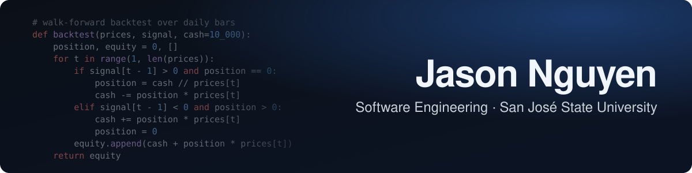

---

Graduating December 2027 and looking for Summer 2027 internships. Interested in quantitative research, software engineering, and machine learning.

---

### Currently Working On

Planning out a Python backtester to test trading strategies on historical data.

---

### Projects

<table>
<tr>
<td width="50%" valign="top">

**[MindMerge](https://github.com/json-ngu/mindmerge)**

A web platform that records the reasoning behind team decisions: the context, the options considered, and why the final choice was made.

 

</td>
<td width="50%" valign="top">

**[Borderify](https://github.com/json-ngu/borderify)**

Built at SJHacks 2026. A browser-based tool that adds borders to photos so Instagram carousels don't auto-crop them.

 

</td>
</tr>
<tr>
<td>

`Java` `JSP` `JDBC` `MySQL` `Tomcat`

</td>
<td>

`TypeScript` `React` `Tailwind CSS` `HTML5 Canvas`

</td>
</tr>
</table>

---

### Tech Stack

**Languages**

**Libraries**

**Tools**

---

### Activity

<picture>
  <source media="(prefers-color-scheme: dark)" srcset="https://raw.githubusercontent.com/json-ngu/json-ngu/output/snake-dark.svg" />
  <source media="(prefers-color-scheme: light)" srcset="https://raw.githubusercontent.com/json-ngu/json-ngu/output/snake-light.svg" />
  
</picture>
